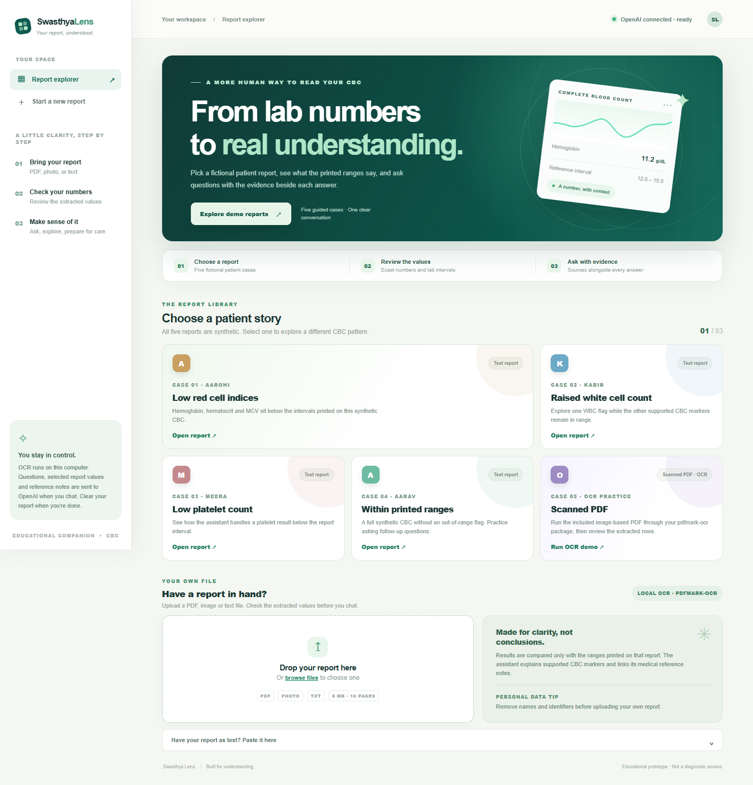
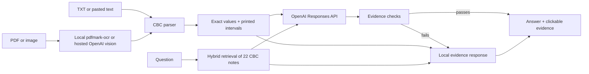
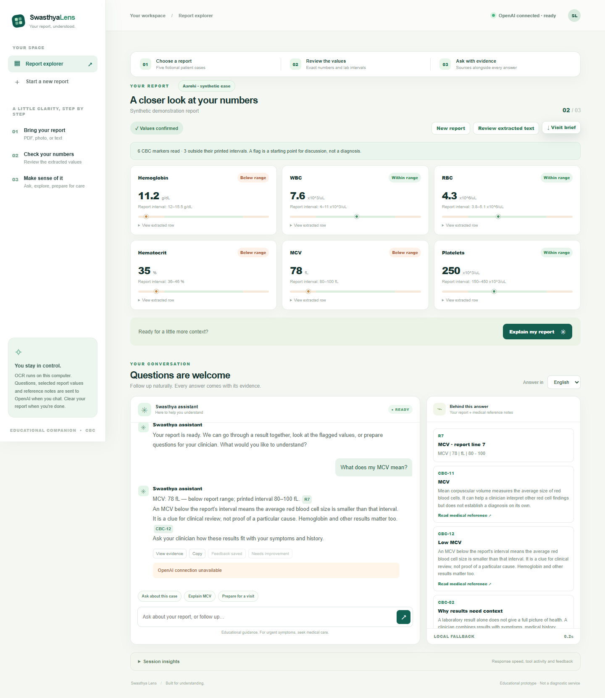

[Deployment](https://ch23b012-edgechat-project.onrender.com)

# Swasthya Lens

**A CBC report companion that shows its work.**

**[Download Diya Gupta's creation write-up (PDF)](docs/Swasthya_Lens_Creation_Writeup_Diya_Gupta.pdf)** — the story behind `pdfmark-ocr`, the problem this project addresses, its design choices, and how it was verified.

**Swasthya Lens** turns a CBC report into reviewed result cards, then answers questions with the relevant report row and medical reference notes beside the conversation. It is an independent Edgechat Wizard work sample inspired by the health copilot idea behind [Bayosthiti AI's Ayu](https://bayosthiti.ai/). It is not affiliated with Bayosthiti AI and is not a diagnostic service.



## Try it in two minutes

1. [Run the app locally](#run-locally), then choose one of the **five fictional patient reports**.
2. Inspect the CBC values against the intervals printed in that report.
3. Ask a question such as **“What does my MCV mean?”** or **“Which values are outside the printed ranges?”**
4. Click an answer citation to see the exact report row or linked reference note.
5. Download the **Visit brief** PDF or try the **Scanned PDF** case to see OCR and value review.

| Demo case | What it demonstrates | Starts ready to chat? |
| --- | --- | --- |
| Aarohi · Low red cell indices | Low hemoglobin, hematocrit and MCV | Yes |
| Kabir · Raised white cell count | WBC above the printed interval | Yes |
| Meera · Low platelet count | Platelets below the printed interval | Yes |
| Aarav · Within printed ranges | A CBC with no displayed flags | Yes |
| OCR practice · Scanned PDF | Local `pdfmark-ocr` or hosted AI vision reads an image-based PDF | Review values first |

Every name and result in the library is synthetic. The same interface also accepts PDF, PNG, JPG, TXT, and pasted report text. User-supplied and OCR-extracted values require confirmation before chat.

## Run locally

Python **3.12** is recommended. From this directory, use the commands for your system:

**Windows PowerShell**

```powershell
py -3.12 -m venv .venv
.\.venv\Scripts\python.exe -m pip install -r requirements.txt
.\.venv\Scripts\python.exe -m uvicorn server:app --host 127.0.0.1 --port 8510
```

**macOS / Linux**

```bash
python3.12 -m venv .venv
./.venv/bin/python -m pip install -r requirements.txt
./.venv/bin/python -m uvicorn server:app --host 127.0.0.1 --port 8510
```

Visit **http://127.0.0.1:8510**. The five sample reports, local OCR, exact range checks, and lexical retrieval work without an OpenAI key. There is no Node build step or external database.

### Deploy on Render

The app is hosted at **[ch23b012-edgechat-project.onrender.com](https://ch23b012-edgechat-project.onrender.com)** on a free Render web service in Singapore. [`render.yaml`](render.yaml) records the same configuration, and [`.python-version`](.python-version) pins Python 3.12 for the local OCR dependency. The Render service has `OPENAI_API_KEY` configured as a secret and `OCR_BACKEND=openai`: PDF and image uploads use OpenAI vision because the free instance's 512 MiB memory limit cannot reliably run RapidOCR. AI chat and semantic retrieval use the same key. Render checks `/api/health`.

### OpenAI configuration

The app reads `OPENAI_API_KEY` from the server environment, this directory's `.env`, or the parent directory's `.env`. An existing `Open_ai_api_key` variable is also accepted. The key stays on the server; `.env` is ignored by Git. To set up a new environment:

```powershell
Copy-Item .env.example .env
# Edit .env and set OPENAI_API_KEY to your key, then start the server.
```

The default chat and hosted OCR model is `gpt-4.1-mini`; semantic retrieval uses `text-embedding-3-small`. `OPENAI_MODEL`, `OPENAI_EMBEDDING_MODEL`, `SEMANTIC_RETRIEVAL`, and `OCR_BACKEND` can be changed in `.env`. With no key or an unavailable AI service, chat falls back to a local, evidence-linked explanation. Local `pdfmark-ocr`, exact range checks, and lexical retrieval work without an API key. Hosted AI OCR requires the OpenAI key.

## What happens to a report



### OCR for scanned PDFs

Scanned reports are the awkward part of a report assistant: text extraction alone may return little or nothing. Locally, this project uses **`pdfmark-ocr`**, a package published under **Diya Gupta CH23B012**, with **RapidOCR** and `page_ocr="auto"`. Images are converted to a PDF first. On Render, the 512 MiB instance uses **OpenAI vision** for PDF and image extraction; the original PDF or image is sent to OpenAI for transcription. Both routes feed the CBC parser and require the user to check every extracted value against the original before chat. The included `sample_scanned.pdf` exercises both paths.

### Grounded answers, not guessed values

- `engine.py` parses **Hemoglobin, WBC, RBC, Hematocrit, MCV and Platelets**. It compares each value only with the interval printed on that report. Missing intervals remain unclassified; conflicting duplicate rows are omitted.
- `knowledge_base.json` contains **22 original, source-linked CBC notes**. It is a small reference library, not a patient dataset. Each note has a stable citation ID and a medical reference URL.
- `retrieval.py` expands aliases such as *Hb* and *WBC*, combines **BM25** and **TF-IDF**, and, when enabled, adds OpenAI embeddings for semantic ranking. Embeddings of the public reference notes may be cached in `.cache`; patient report text is not stored there.
- `assistant.py` supplies selected report rows and retrieved notes to the model. Function calls give it an exact `lookup_result` tool and an explicitly requested **mock** `request_consultation` tool. A post-answer check rejects unknown citation IDs, unsupported numbers, and some unsupported clinical assertions; a rejected answer is replaced with a local evidence response. These checks do not establish clinical accuracy.
- The evidence panel exposes report lines, note text, links, response mode and latency. Session insights show query counts, feedback, retrieval time and tool activity.

The downloaded Visit brief repeats confirmed report values and suggests questions for a clinician. The consultation tool records a local demo request; it does **not** contact or book a clinician.

## Why this fits the Edgechat Wizard assignment

| Capability | In this prototype |
| --- | --- |
| Conversational design | Guided report selection, suggested questions, follow-up chat and English/Hindi answer option |
| RAG | Source-linked CBC notes with hybrid lexical and semantic retrieval |
| Function calling | Exact result lookup and guarded mock consultation request |
| API integration | OpenAI Responses and embeddings APIs |
| Hallucination control | Deterministic values, printed intervals, citation and numeric checks, evidence fallback |
| Local processing | `pdfmark-ocr` + RapidOCR on capable hosts, plus a local retrieval fallback |
| Evaluation | Automated app checks, browser walkthrough, feedback and latency metrics |

## Verification

Install `requirements-dev.txt` in the same virtual environment. On Windows:

```powershell
.\.venv\Scripts\python.exe -m pip install -r requirements-dev.txt
.\.venv\Scripts\python.exe -m pytest -q
# Start the server on port 8510 in another terminal before this step:
.\.venv\Scripts\python.exe scripts\browser_check.py
```

The latest run passed **35 tests**. They cover the five sample choices, CBC parsing, local and hosted scanned-PDF OCR, review gating, citations, conversational greetings and farewells, follow-up questions, safety responses, brief generation and API behavior. The Chrome walkthrough checked report selection, citations, feedback, PDF download, a 390 px mobile viewport, the platelet case and the scanned-PDF review flow. [`docs/live-verification.json`](docs/live-verification.json) records a separate synthetic-data OpenAI walkthrough, including source IDs, tool calls and latency. These are software checks, not clinical validation or a measure of medical accuracy.



## Data handling and scope

Use the synthetic reports for a demo. If you try a personal report, remove identifying details first. On Render, PDF and image uploads are sent to OpenAI for transcription. Local runs use `pdfmark-ocr` unless `OCR_BACKEND=openai` is set. When AI chat or semantic retrieval is enabled, the question, selected report rows and reference notes are sent to OpenAI. Report sessions, mock consultation requests and recent metrics live in server memory and disappear on restart. No report text or chat content is written into the metrics log.

The app supports six CBC markers only. It does not diagnose, prescribe, authenticate users, keep longitudinal records, or schedule real care. The emergency route directs users with urgent symptoms to immediate medical help. A production healthcare product would need clinical review, secure storage, identity controls and a validated workflow.

## Project files

| File | Role |
| --- | --- |
| `static/` | Responsive report library, results view, chat and evidence panel |
| `server.py`, `ocr_worker.py` | FastAPI routes, hosted AI OCR, local OCR worker and short-lived sessions |
| `engine.py` | CBC row parsing and exact range checks |
| `retrieval.py`, `knowledge_base.json` | Hybrid RAG over cited CBC notes |
| `assistant.py`, `provider.py` | Chat safety, tool calls and OpenAI adapter |
| `sample_report.txt`, `sample_reports/`, `sample_scanned.pdf` | Fictional demonstration data |
| `tests/`, `scripts/browser_check.py` | API and browser verification |

The application and UI are original to this repository; the published `pdfmark-ocr` package is installed as a dependency. Bayosthiti and Ayu are cited as inspiration for the use case, with no claim of affiliation.
